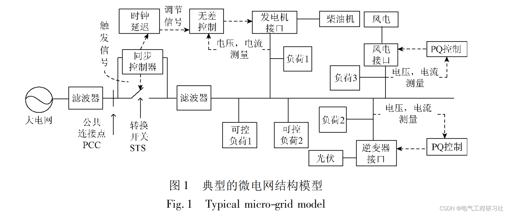
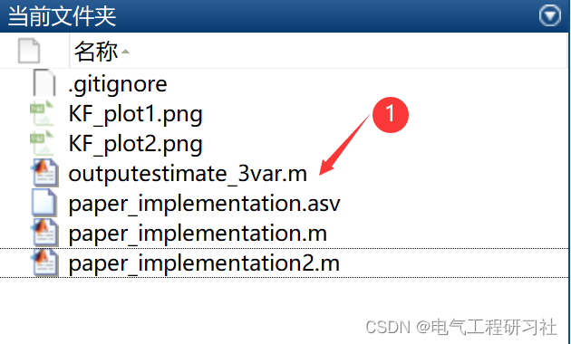
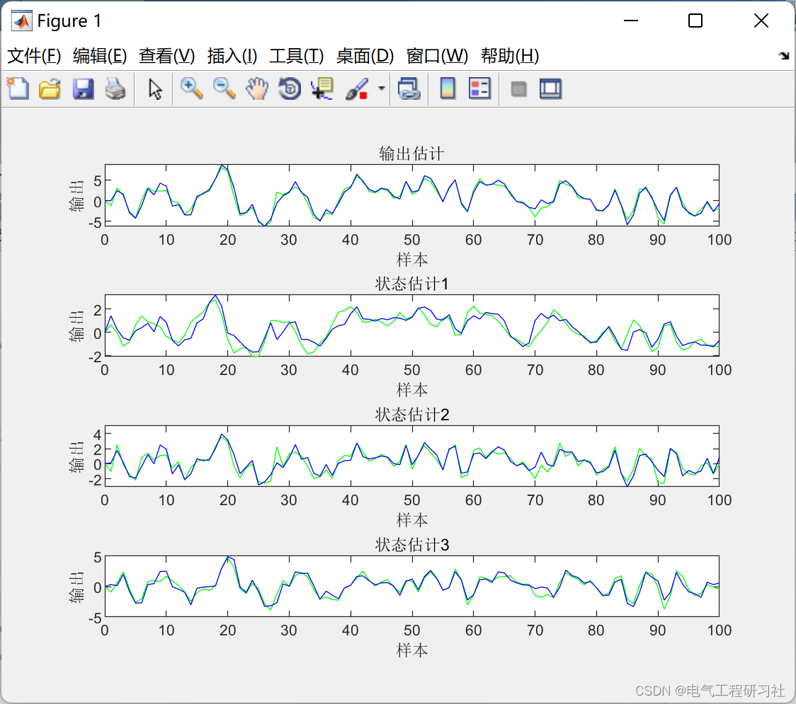
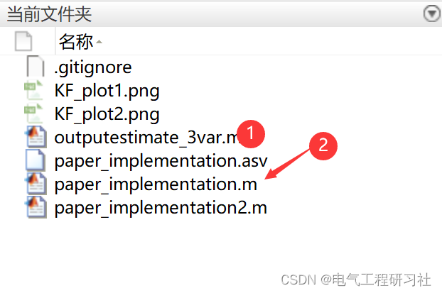
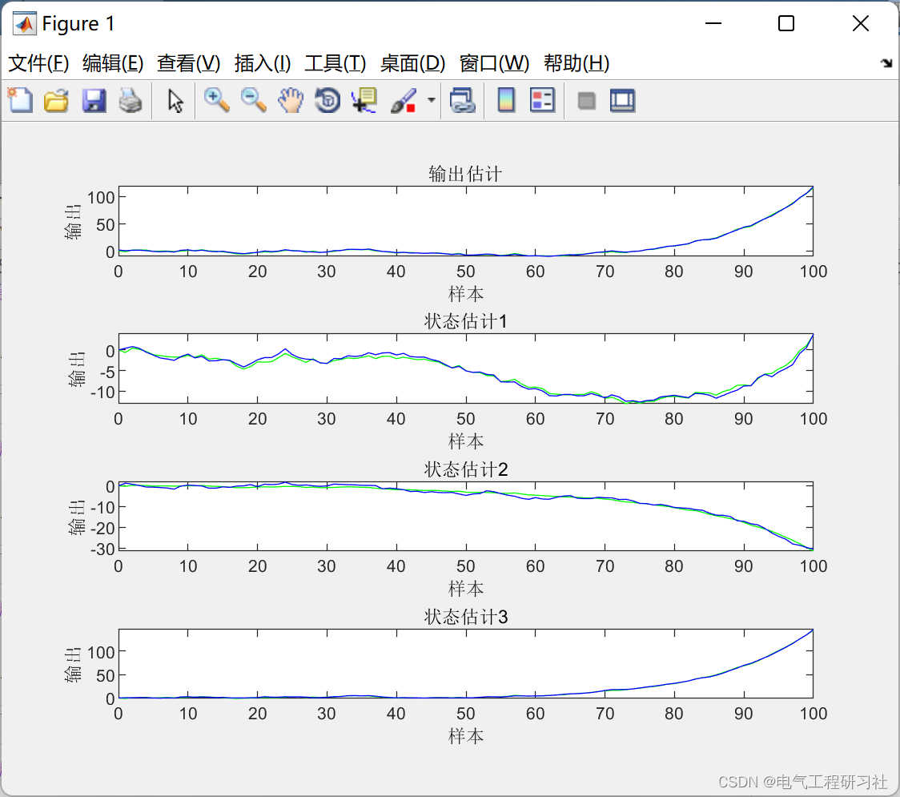
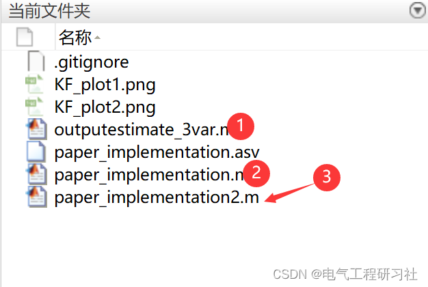
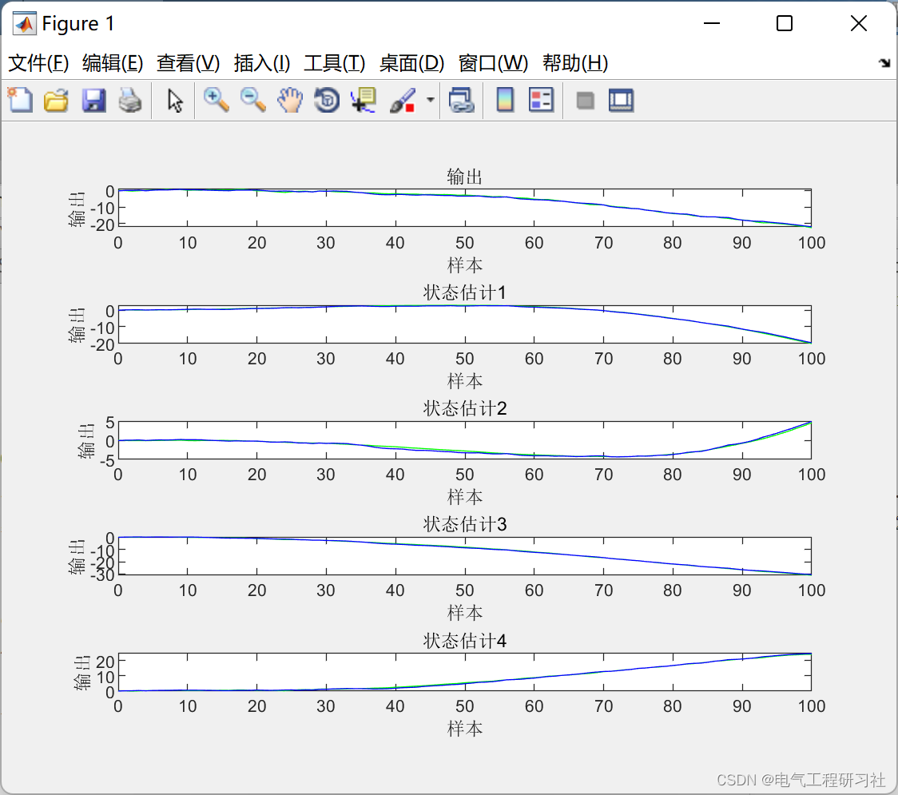

# Microgrid Dispatch Based on Kalman Filter (Matlab Code Implementation)

The content of this article is as follows: ⛳️⛳️⛳️1. Overview
2. Kalman Filter Principle
3. Microgrid Structure and Control Methods
4. Operation Results
5 MATLAB Code Implementation
6. Final Thoughts
1. Overview
2. Kalman Filter Principle
3. Microgrid Structure and Control Methods
4. Operation Results
5. MATLAB Code Implementation
6. Final Thoughts
clf\nsubplot(411);\nplot(t, y_true, 'g', t, y_estimate, 'b');\nxlabel('Sample'), ylabel('Output')\ntitle('Output estimation')\n\nsubplot(412);\nplot(t, x1_true, 'g', t, x1_estimate, 'b');\nxlabel('Sample'), ylabel('Output only')\ntitle('State estimation1')\n\nsubplot(413);\nplot(t, x2_true, 'g', t, x2_estimate, 'b');\nxlabel('Sample'), ylabel('Output only')\ntitle('State estimation2')\n\nsubplot(414);\nplot(t, x3_true, 'g', t, x3_estimate, 'b');\nxlabel('Sample'), ylabel('Output')\ntitle('State estimation3')\n  
6. References to theoretical literature are included in the final section, and if any infringement occurs, please contact the blogger for removal.

## Images

<!-- PAYMENT_BLOCK -->

## Get this dataset

- Payment link (Stripe): [Buy now](https://buy.stripe.com/3cs8yP7sY87d0vu9AB)
- Payment QR code: 

<!-- /PAYMENT_BLOCK -->
